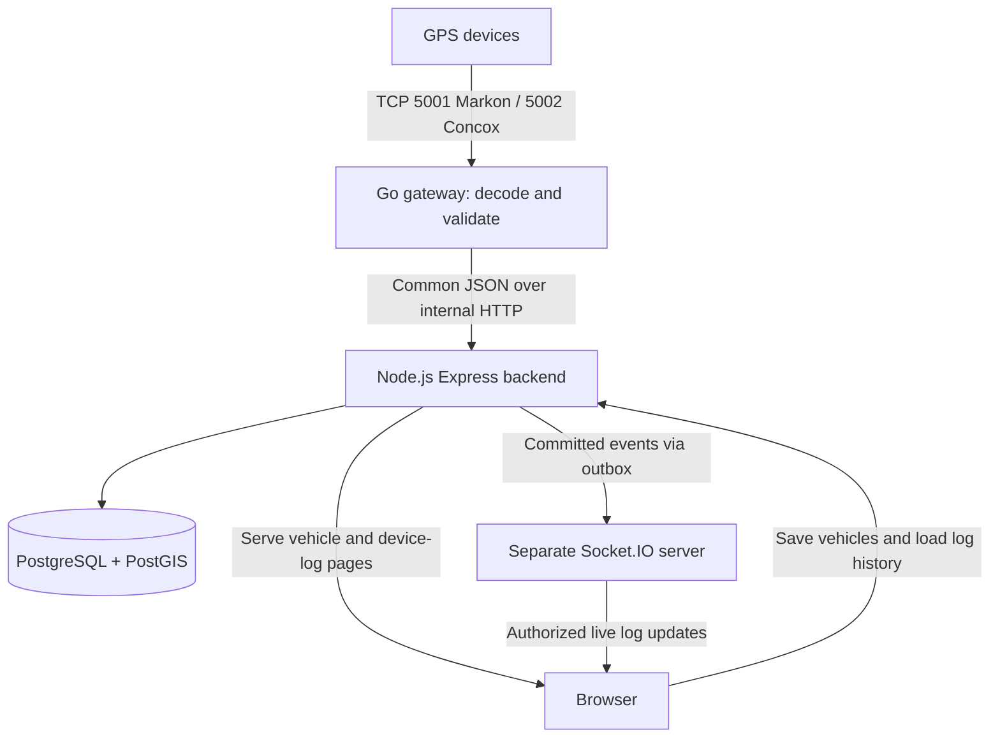

# GPS vehicle registration and decoded device logs — implementation plan

Status: proposed plan only. Application implementation requires explicit approval.

## 1. Scope and repository findings

The directory contains the two supplied GPS protocol PDFs and AI_AGENT_PROMPT.md. There is no existing application, package.json, lockfile or deployment configuration to extend. Both PDFs were reviewed during the architecture discussion; their unresolved details remain gates below.

This single document replaces the earlier ten-document specification for the first delivery. The latest request narrows the user interface to **two Express-served pages**:

1. **Vehicles:** add and manage vehicle details and the attached GPS device.
2. **Device logs:** inspect persisted, properly decoded device messages, with live updates.

A small login screen supports these pages. Keep Go ingestion, the Express API, the separate Socket.IO application, PostgreSQL/PostGIS and Nginx. Express serves the HTML pages; no separate React/Vite application or frontend runtime is needed for this delivery. This is an explicit change from the original broad prompt. Map tracking, geofences, calculated alert rules, reports, command sending and full administration screens remain later phases; received device alarms still appear as decoded log events.

**Assumption for review:** one organization is used initially, with tenant-scoped records and admin/operator/viewer roles so other organizations can be introduced safely. Each vehicle has at most one active tracker, and each tracker has at most one active vehicle assignment. Historical assignments are retained.

## 2. Simple architecture



The browser never connects to a tracker or the gateway. The gateway never renders pages or decides user permissions. Socket.IO delivers committed updates; PostgreSQL holds the permanent log history.

### Components and libraries

| Component | Technology | Responsibility |
|---|---|---|
| GPS gateway | Go; standard net, encoding/binary, encoding/json, log/slog; embedded SQLite spool with a maintained Go driver | TCP framing, protocol/model adapters, identity binding, checksum validation, acknowledgements, normalization and retryable forwarding |
| Backend | Supported Node.js LTS, Express, TypeScript | Authentication, registration, assignments, ingestion, database transactions, page rendering and internal jobs |
| Database access | pg + Drizzle ORM/Kit | Parameterized SQL, transactions and migrations; explicit SQL for PostGIS/assignment exclusion constraints |
| HTML pages | EJS, ordinary CSS and small browser JavaScript modules | Backend-served forms, tables, detail drawer and safe DOM updates; native fetch for JSON endpoints |
| Validation and logging | Zod, pino/pino-http, helmet, express-rate-limit | Validated requests, useful errors, request IDs and bounded public traffic |
| Authentication | express-session, connect-pg-simple, argon2 | Server-side sessions in PostgreSQL, secure cookies and password hashes |
| Realtime | Separate Express + TypeScript + socket.io application; socket.io-client in browser | Authenticated subscriptions and new-log/status events |
| Deployment | Docker Compose, Nginx, Linux VM | HTTPS, routing, process isolation and persistent volumes |
| Verification | Go test/fuzz/race; Vitest, Supertest and Playwright | Protocol correctness, real database integration and browser flows |

EJS is recommended because two forms/tables do not need a full client application. Escape all device-provided values; never render raw packets as trusted HTML. Pin supported compatible package versions during approved scaffolding. Drizzle keeps this SQL-oriented project straightforward; Prisma is an alternative but adds no required benefit here. Go suits concurrent long-lived sockets and binary parsing. No NestJS, Redis, Kafka, Kubernetes or generic dependency injection framework initially.

## 3. Page one: vehicles and attached devices

Route: **GET /vehicles**. Admin/operator can create and edit; viewer can read. Destructive/reassignment actions require admin initially.

### Page layout

- Table: vehicle name, registration number, IMEI, manufacturer/model, enabled status, last communication, connection/activity status and actions.
- Search by name, vehicle number or IMEI; paginated results.
- Add Vehicle button opens an inline form or accessible modal on the same page.
- Edit, replace tracker, deactivate, and View Logs actions. View Logs navigates to `/device-logs?deviceId=...`.
- Clear success/errors, field validation, empty state and disabled submit while saving.

### Registration fields

| Field | Required | Rules / meaning |
|---|---|---|
| Vehicle name | Yes | Trimmed descriptive label, 1–100 characters; e.g. Delivery Van 1 |
| Vehicle registration number | Yes | Display value retained; normalized comparison key uppercases and removes agreed separators; unique within organization; 1–32 characters; do not enforce one country's plate regex globally |
| IMEI | Yes for initial supported profiles | Exactly 15 decimal digits as a string, not a number; globally unique registered device; device identifier is distinct from internal device UUID |
| Manufacturer | Yes | Controlled value initially Markon/Concox; never enough by itself to choose parser |
| Device model | Yes | Explicit actual hardware model; unsupported model can be saved only as disabled/pending verification |
| Firmware version | Optional at entry | Record from inventory/login where available; unknown firmware visibly unverified |
| Protocol profile | Yes to enable ingestion | Server-maintained allowlist of tested protocol/model variants; no browser-provided parser code |
| Vehicle type | Optional | Car/van/truck/bus/other with extensible validated values |
| Expected reporting/heartbeat interval | Optional | Positive seconds with server bounds; default profile settings; displayed as expected configuration, not a claim the tracker has been remotely configured |
| SIM phone number / operator | Optional | Sensitive operational information; restrict to admin, mask in lists; country-aware phone validation |
| Description/notes | Optional | Plain text <=1000 characters |
| Enabled | Yes | Default enabled only for verified profile, otherwise pending/disabled |

Driver name/phone can be added later if required; do not introduce a driver-management module for these pages.

### Save flow and assignment safety

1. User logs in and submits validated form with CSRF protection.
2. Express derives organization from the session. Client cannot pick an arbitrary tenant.
3. In one transaction create vehicle, device and active assignment, plus audit entry. All succeed or none do.
4. Duplicate IMEI or registration returns a field-specific 409; concurrent requests are protected by DB uniqueness, not just a prior lookup.
5. Gateway registry refreshes at most 60 seconds later. After a registration cache miss it may perform one bounded authenticated lookup, rate-limited; failure remains unregistered, never auto-enrolls.
6. Show server address and protocol port as a **provisioning instruction**. Saving a vehicle does not configure its GPS hardware. Actual manufacturer SMS/configuration method must be confirmed separately.

IMEI edits are not ordinary vehicle edits. Replacing a device closes the previous assignment and opens a new one at an explicit UTC effective time. Do not rewrite old log ownership. Reusing an already registered unassigned tracker requires an explicit authorized assignment flow, not a duplicate device record. Overlapping active assignments are rejected. Vehicle deactivation preserves history; device deactivation revokes new ingestion and terminates sessions within the documented registry refresh bound. Transfer between organizations is disabled until an ownership/history policy is agreed.

## 4. Page two: decoded device logs

Route: **GET /device-logs**. Requires login and authorized organization/device access. This page reads stored decoded records, not container stdout.

### Table and controls

- Filters: vehicle/device, IMEI, protocol, packet/event type, received-time range, decode result, live paused/running.
- Columns: received time, device time, vehicle name/number, IMEI, protocol, packet type, decoded summary, checksum/decode status and Details.
- Summary examples: `LOCATION — 23.022500, 72.571400; 45 km/h; ignition ON` or `HEARTBEAT — battery level 4; GSM level 3`.
- Show unknown/unavailable as `Unknown` or `Not provided`, never 0, OFF or a fabricated percentage.
- Details drawer: normalized fields grouped by identity, time, location, vehicle state, power, network, alarm and validation. Also show structured decoded JSON and bounded raw ASCII/hex if retained and authorized.
- Distinguish `Decoded`, `Decoded with unverified checksum`, `Unsupported packet`, `Invalid checksum` and `Malformed`.
- Show historical/reupload marker, timestamp quality and model/profile used. Display UTC with optional local rendering; make both timestamps visible.
- Clearly label units; categorical Concox battery level is not battery percent.
- View newest records first using received time plus unique ID, with server cursor pagination (default50, max200). Limit selected time range initially to7 days per request.
- Live mode adds only matching authorized events, caps visible rows at200, and batches DOM insertion. Pausing stops display updates, not ingestion/storage; show pending-count hint and reload on resume.
- Loading older pages freezes live insertion into that table to avoid shifting records. Resume returns to newest page. Browser reconnect refetches current page; sockets are not a replay store.

### What “proper decoded data” means

A record contains fields actually decoded from its packet, their canonical units, raw source codes and validation evidence. Heartbeats/login packets do not pretend to contain a location. An unsupported field is explicitly unavailable. Invalid bytes never appear as a successfully decoded location. The UI can inspect protocol-specific decoded fields under `protocolData`; normal business processing uses only the common normalized contract.

For unknown device traffic, do not map attacker-provided IMEI to a vehicle without verification. Ordinary operators see only registered device logs. Bounded unknown-device connection/rejection diagnostics are admin-only and not a global publicly searchable packet stream. Malformed data without an attributable identifier is labeled connection diagnostic, not vehicle data. Diagnostic flooding is sampled/rate-limited.

Example illustrative detail, not a guaranteed captured packet:

```json
{
  "schemaVersion": 1,
  "eventId": "<uuid>",
  "deviceIdentifier": "358980100675496",
  "protocol": "MARKON_AIS140",
  "profile": "<verified-profile-id>",
  "packetType": "NRM",
  "eventType": "LOCATION",
  "deviceTimestamp": "2026-11-03T07:00:00Z",
  "receivedAt": "2026-11-03T07:00:02Z",
  "historical": false,
  "location": {"latitude":23.0225,"longitude":72.5714,"speedKph":45,"headingDegrees":120},
  "status": {"ignition":true,"gpsValid":true,"batteryPercent":null},
  "validation": {"decodeStatus":"DECODED","checksum":"UNVERIFIED","warnings":["Vendor checksum algorithm not supplied"]},
  "source": {"sequence":"000045","rawSha256":"<64 hex characters>"},
  "protocolData": {"packetType":"NR","alertId":"01"}
}
```

Store parser version/profile with every log, so future decoder fixes do not silently change what was originally understood. Reprocessing raw records, if added later, must preserve original interpretation and version the correction.

## 5. Device communication and extensibility

### Identification and mapping

`protocol family → registered IMEI → tested model/firmware profile → organization → assignment at observation time`.

The port selects an allowed protocol family; actual bytes and registered profile must agree. Vendor name alone is not parser identity. Concox packets after login usually omit IMEI and inherit the validated session identity. Markon identifiers on subsequent frames must match the bound device. A new login cannot silently hijack an existing live session; log conflicts and enforce a tested generation/reconnection policy.

Same tested hardware: register another IMEI, no parser change. New model with existing protocol: verify optional fields and ACK behavior, add a profile. New protocol: add a separate adapter producing the existing canonical event; API/pages do not need vendor-format logic. Maintain a capability allowlist, not a promise all devices support all fields.

### Protocol facts and gates

| Area | Confirmed from supplied PDFs | Unresolved / implementation consequence |
|---|---|---|
| Markon framing | ASCII comma-separated LGN/NRM/HBT, generally `$,` start and `*` end; pp.4–27 | Preserve empty fields; no universal comma count; maximum frame size needs capture |
| Markon login/HBT | LGN contains IMEI/model metadata; login response `$LGN` + UTC DDMMYYYYhhmmss + `*`; HBT response `$HBT*`; pp.6–7/25–27 | Verify exact device/firmware bytes; NRM ACK unspecified, do not invent one |
| Markon conversion | Decimal-degree coordinates with hemisphere, speed km/h, heading degrees; DDMMYYYY + hhmmss UTC, ignition0/1, L/H history; pp.16–20 | Validate GPS fix before current location use; capture OTA variants and sequence behavior |
| Markon checksums | NRM four hex digits, described CRC coverage through serial; emergency EPB has checksum after `*`; pp.23/28–29 | Algorithm parameters absent. NRM cannot be labeled checksum-verified. EPB framing/CRC disabled until clarified. No guessed CRC |
| Concox envelope | `7878 + one-byte length` or `7979 + two-byte length`; protocol/body/serial/CRC/0D0A; p.4 | Binary length-driven framing, not delimiter splitting; total length L+5/L+6 |
| Concox identity/ACK | Login01 includes packed-decimal identifier/model; heartbeat13 or EG02/EG03 variant23; pp.5–8 | Validate BCD and actual model mapping; reply with matching request serial and proper CRC |
| Concox CRC | Appendix p.34: initialFFFF, reflected table update, final complement; covers length through serial | Port exact appendix and validate known vectors, not a library selected only by CRC name |
| Concox location | 22, also mentions12; six binary time bytes; latitude/longitude u32 /1,800,000; course/status word; pp.9–11 | Profiles govern optional ACC/reupload/mileage; confirm actual firmware year base/time/speed units. Location has no server reply |
| Concox signs/status | Course low10 bits; high-byte bit4 fix, bit3 west, bit2 north; terminal ACC bit1 | Do not confuse tracking-enabled bit with current fix or differential flag with history flag |
| Concox alarms | 26/27 GPS alarm variants,19 LBS alarm; pp.16–22 | 27 example/length inconsistencies, language00 reply ambiguity and missing19 reply format require vendor evidence. Do not universally ACK every packet |
| Special packets/commands | Concox 28/2C/94 no response; 80 commands and model-specific21/15 replies documented; pp.12–15/23–30 | Commands, WiFi/LBS positioning, files and government relay outside first delivery; unsupported frames visible as diagnostics where safe |
| Reconnect timing | Concox prose mentions5s reply/three timeouts, diagram uses different timing; pp.5/7/35 | Confirm firmware; target fast local ACK, not a universal inferred timeout |

Historical/reupload records remain stored with both source and receive timestamps. They do not overwrite newer location/ignition. Each latest-state field has its own observed time; a heartbeat can update activity without replacing the last GPS position. Backlog uses assignment effective at trustworthy source time; unknown/skewed timestamps retain device-only association until resolved.

**Release gate:** without vendor checksum details and hardware captures, Markon checksum validation is incomplete. Diagnostic decoding can explicitly show UNVERIFIED, but enabling unverified production ingestion needs review. Do not treat parsing success as checksum success or genuine device authentication.

## 6. Complete processing and reliability flow

1. Device opens outbound TCP to configured address/port. Go buffers partial reads and extracts multiple complete frames from a read. Per-profile maximum buffers, deadlines, rate limits and bounds checks apply.
2. Decode and validate frame; bind registered identity/profile. Known-invalid CRC cannot become a business event. Persist bounded diagnostic details separately for the log page.
3. Build normalized event with stable eventId, receive time and source hash. Append to local persistent queue before a required ACK. Recommended queue: SQLite WAL with FULL synchronous writes on a named volume; benchmark fsync against protocol deadline.
4. Send only protocol-required ACK through the same session. It confirms the defined device-protocol step, not database persistence. Go does not wait for the API or browser to reply to the tracker.
5. Forward authenticated JSON to Express. Retry network/5xx with exponential jitter (1s to30s cap); permanent schema errors enter bounded quarantine. Keep eventId unchanged across retries. Per-device FIFO, bounded cross-device concurrency.
6. Express resolves tenant/device and assignment, validates contract and performs one transaction: receipt/dedupe, decoded log, history where appropriate, latest-state change and realtime outbox. Diagnostics cannot change current GPS state.
7. Respond success only after commit. Gateway removes queued record only after matching committed response. Lost response safely retries.
8. An API background outbox job sends committed log/status IDs and authorized targets to realtime via internal HTTP. Leases/advisory locks prevent competing job ownership; duplicates remain possible and harmless to the browser.
9. Realtime broadcasts to authorized device/org rooms. Initial load, filter changes and reconnect load saved logs through Express; event/log IDs dedupe live rows.

Gateway queue proposed cap1GiB with warning70%/critical85%; pending accepted records must not silently expire. When full/disk fails, stop durable admission and alarm; close/refuse as protocol permits. Devices with no retry/ACK may lose data. Local queue survives restart, not disk destruction. No zero-loss promise.

Use eventId uniqueness for HTTP retries. Device retransmission dedupe additionally needs protocol/timestamp/sequence/raw hash and tested window; serial alone wraps/resets. Heartbeats with identical bytes may be legitimate and must not be deduped forever. Latest state is monotonic by trustworthy device time; liveness uses latest accepted receive time, not the age of uploaded GPS history.

## 7. Database design

Use one PostgreSQL instance with PostGIS, timestamptz/UTC, migrations and parameterized SQL. All tenant-owned rows carry organization_id. Internal identifiers are UUIDs; IMEI remains text. Composite tenant-aware foreign keys protect associations.

| Table | Essential fields and rules |
|---|---|
| organizations | id, name, timezone, enabled, created_at |
| users | id, organization_id initially, email unique normalized, password_hash, role, enabled; membership table when multi-org users needed |
| sessions | PostgreSQL-backed express-session data and expiry; cleanup expired sessions |
| vehicles | id, organization_id, name, registration_number, registration_key, vehicle_type, notes, enabled, created_at, updated_at; unique(org,registration_key) |
| devices | id, organization_id, imei globally unique, manufacturer, model, firmware, protocol, profile_id, enabled, expected intervals, sensitive SIM metadata, last_received_at |
| vehicle_device_assignments | id, org, device_id, vehicle_id, valid_from, valid_to nullable; half-open intervals; prevent overlap per device and per vehicle using constraints/transactions |
| ingestion_receipts | event_id unique, org, device_id, source_fingerprint nullable, received_at, persisted_at; dedupe effects in same transaction |
| device_logs | id, event_id, org, device_id nullable, vehicle_id nullable, connection_id, received_at, device_time nullable, protocol, packet_type, event_type, decode_status, checksum_status, normalized_data jsonb, protocol_data jsonb, parser_version, warnings jsonb, raw_ascii/raw_hex nullable, raw_hash, historical, diagnostic_scope |
| gps_points | id, event_id unique, org, device_id, vehicle_id nullable, device_time, received_at, position geometry(Point,4326), speed_kph, heading_degrees, ignition nullable, gps_valid, historical, quality_flags |
| vehicle_latest_state | vehicle_id unique, org, device_id, latest valid position/motion, field observation times, last_received_at, online, connection_state, revision bigint |
| realtime_outbox | id, org, device_id, vehicle_id nullable, event_name, log_id/payload, next_attempt_at, attempts, lease_until, dispatched_at |
| audit_logs | actor, org, action, target, redacted changes, time; append-only application access |

Keep only one decoded JSON copy in device_logs, not several full payload copies across tables/outbox. Outbox can reference committed log ID and send a bounded summary. Remove raw fields independently after short retention. If log retention expires while notification is pending, dispatcher must detect missing row and force resync rather than invent data.

Indexes: device_logs(org,received_at DESC,id DESC), (org,device_id,received_at DESC,id DESC); unique receipt/event IDs; vehicles(org,registration_key); devices unique imei; gps_points(org,vehicle_id,device_time,id); pending outbox partial index. Add JSON/GiST log/history indexes only for actual queries; PostGIS future fences use GiST and explicit spatial SQL. Points are longitude=X, latitude=Y, SRID4326.

Proposed retention: decoded logs30days, raw bytes7days, GPS90days, audit365days, dispatched outbox24h. Confirm budget/privacy before launch. Cap/sampling for malformed/unknown diagnostics. Retain dedupe receipts at least maximum retry/replay horizon; reject or explicitly archive older replays once ledger expires. Initially batch-delete expired data, monitor vacuum. Introduce time partitions when measured volume/maintenance justifies it; global event uniqueness remains in receipt ledger since partitioned unique keys require partition key.

No current assignment join may relabel historical records. Display logs against immutable event association and optionally clearly labeled current device label. Unknown/invalid event timestamps do not automatically map to current vehicle. Separate latest-state rows make status listing cheap without scanning history.

## 8. HTTP and realtime contracts

### Public routes

| Method / path | Purpose |
|---|---|
| GET/POST /login; POST /logout | Session login/logout, throttling and CSRF |
| GET /vehicles | Server-rendered management page |
| GET /device-logs | Server-rendered log viewer shell and initial authorized selection |
| GET /api/v1/vehicles | Search/paginated vehicle/device/state list |
| POST /api/v1/vehicles | Atomic vehicle+device+assignment registration |
| PATCH /api/v1/vehicles/:id | Edit ordinary vehicle fields |
| POST /api/v1/vehicles/:id/device-assignment | Assign/replace tracker explicitly at effectiveAt |
| PATCH /api/v1/devices/:id | Admin device enable/profile/metadata management; no arbitrary parser definitions |
| GET /api/v1/devices | Authorized filter options; scoped search |
| GET /api/v1/device-logs | Filtered keyset history, response {items,nextCursor} |
| GET /api/v1/device-logs/:id | Authorized decoded detail and role-restricted raw data |
| POST /api/v1/realtime-ticket | Single-use short-lived ticket from active session |

Server enforces all permissions, bounds and filters. No authorization based only on hidden buttons. UUID paths are checked against session organization. GET log detail must not bypass raw-data permissions. Validate sort/filter allowlist and bound date range/limit.

### Private routes

- API `POST /internal/v1/events`: normalized accepted events; commit response `{eventId,persisted:true,duplicate:false}`. Invalid packet diagnostics use a separate typed diagnostic envelope on this endpoint, with strict size/rate limits and admin visibility.
- API `GET /internal/v1/device-registry`: authenticated gateway registry/profile configuration; versioned, narrow data exposure. Bounded identifier lookup supports immediate registration visibility.
- API `POST /internal/v1/realtime-tickets/consume`: realtime validates and atomically consumes ticket; checks active session.
- API `POST /internal/v1/subscriptions/authorize`: realtime checks requested device/org access.
- Realtime `POST /internal/v1/events`: authenticated outbox event delivery; response means accepted for broadcast, not browser receipt.
- Each service `/health/live` and `/health/ready`: private health endpoints.

Socket events: `device:log` (eventId/logId, deviceId, vehicleId, receivedAt, bounded summary and decode status), `device:status` (activity/connection state and revision), `subscription:ready`, `resync:required`. Server constructs rooms `org:{id}:devices` for full-org permission or `device:{id}` for explicitly authorized devices. Browser cannot join arbitrary room strings. No raw packet/secrets in ordinary broadcasts; details loaded under HTTP authorization.

## 9. Authentication and security

**Device:** pre-register IMEI/profile; gateway validates login and enabled state. IMEI and CRC are not authentication proofs. Supplied PDFs do not establish strong credentials for the actual units. Confirm authenticated device TLS/secret support; private APN/VPN where feasible; document risk if public plain TCP. TLS encryption without device credential validation alone does not prove device ownership.

**User:** Argon2id password verification, PostgreSQL server-side sessions, HttpOnly Secure SameSite=Lax cookie, CSRF token plus Origin checks for mutations; rotate session on login. No production default password; bootstrap admin through one-time CLI/setup procedure. Restrict raw payload/SIM visibility to admin. Audit registration, replacement, profile changes and deactivation.

**Socket:** logged-in browser obtains30-second single-use ticket; realtime consumes via API, authorizes requested rooms, periodically revalidates session/membership (proposed60s) and disconnects expired/revoked users. Validate Origin and rate-limit subscriptions. Initial scope single org/user; future vehicle grants require authorization extension before external multi-tenant release.

**Internal services:** separate rotating service secrets and private Docker networking; no public /internal routing. Least-privilege DB users, no gateway DB credentials, escaped HTML/textContent for device values, SQL parameterization, request/frame size caps, log redaction and protected backups. Before multiple organizations use the service, add/test RLS with transaction-local tenant context and non-owner runtime role as defense in depth.

## 10. Deployment and ports

| Port | Exposure | Purpose |
|---|---|---|
| TCP5001 | Public device ingress | All supported Markon messages on the same device connection |
| TCP5002 | Public device ingress | All supported Concox messages on the same device connection |
| TCP443 | Public | Browser HTML, CSS/JS, REST and Socket.IO through Nginx |
| TCP80 | Public if needed | HTTPS redirect and ACME verification |
| TCP3000 | Docker network only | Express pages/API |
| TCP3001 | Docker network only | Separate realtime app |
| TCP5432 | Docker data network only | PostgreSQL |
| TCP8081 | Docker network only | Gateway management/health |

These numbers5001/5002 are deployment choices, not PDF-mandated defaults. Confirm hardware can configure server IP/domain+port. Many trackers share each listening port, each with its own connection and identity; no port per vehicle or message type. ACKs return on the existing connection. No UDP listener unless a later confirmed protocol requires it.

Nginx proxies `/socket.io/` to realtime:3001 with upgrade support, everything else to api:3000, while denying `/internal/` and private health/debug paths. Express serves templates/static assets; Nginx remains TLS reverse proxy. Socket proxy timeout must exceed configured ping interval+timeout. Keep database and gateway control unexposed; Docker port publishing/firewall behavior must be checked externally. Device DNS must resolve to reachable TCP ingress, not a web-only proxy. Native tracker TLS is separate from browser HTTPS.

Compose containers: gateway, API, realtime, PostGIS, Nginx. Named volumes for pgdata and gateway spool; certificates/secrets mounted appropriately; JSON stdout logs rotated; nonroot application processes, memory limits, health checks and restart-unless-stopped. Graceful shutdown drains requests/ACKs and flushes spool. No application down -v during updates.

Pilot estimate: 2vCPU/4GiB RAM/40–60GiB SSD preferred; 2GiB constrained,1GiB insufficient as a reliable all-service target. Build images elsewhere. AWS/Oracle VM chosen only after current quote/account eligibility/availability and ARM compatibility checks; no free-tier guarantee or current pricing assumption here.

Nightly encrypted off-VM PostgreSQL backup with checksum/age alerts and monthly restore drill. Proposed RPO24h/RTO4h only after successful rehearsal; local spool does not protect against destroyed VM storage. Migrations run once with backups and compatible rollback strategy; immutable image tags. Essential metrics: connections, parse/CRC failures, ACK latency, spool size/age, DB commit latency, outbox lag, last device activity, disk/memory, backup age and browser reconnects. No full monitoring stack required initially.

## 11. Failures and recovery

| Scenario | Required handling |
|---|---|
| Partial or combined TCP reads | Buffered model-specific framing and bounded resynchronization; fuzz every split/concatenation |
| Malformed/invalid CRC | Visible bounded diagnostic, no accepted GPS state, only documented ACK behavior |
| Unregistered/disabled device | Reject enrollment/updates; admin diagnostic; no automatic org mapping |
| Device disconnect/reconnect | Clean session lifecycle/generation; received activity independent of socket connection and GPS fix |
| Backend/DB unavailable | Gateway disk spool/retry; no false persisted response; readiness exposes outage |
| Duplicate/late records | Idempotent transaction, preserved source/received time, no rewind of latest state |
| Realtime/browser outage | Outbox retry and REST reload; live table dedupe and bounded row count |
| Disk full/restart | Admission cap/alert, durable volume recovery; acknowledge loss limits for bytes never persisted |
| Unknown packet/model | Preserve safe bounded diagnostic; enable only tested profile, never guess layout |

Online default may use max(3×expected activity interval,120s), checked every15s, but must respect parked/sleeping firmware. UI shows last communication and last location separately. Arbitrary bytes do not refresh liveness.

## 12. Implementation phases and acceptance

| Phase | Tasks and output | Acceptance / testing / risks |
|---|---|---|
| 1. Evidence and contracts | Confirm model/firmware, checksum/ACK gaps, capture real login/HBT/location/alarm/backlog; define JSON schemas and expected fixtures | Known fields/ACKs verified independently; unknown profiles visibly disabled. Vendor gaps can block affected parsers |
| 2. Foundation and registration | Express/TS, Drizzle migrations, auth, EJS vehicle page, atomic registration/assignment/audit, scoped registry | Required details saved atomically; duplicate/concurrent IMEI and plate rejected; unauthorized/cross-org access fails; Supertest+real PostGIS tests |
| 3. Gateway and ingestion | Go listeners/adapters, profile binding, stream validation, spool, internal event ingestion, logs/history/latest state | Golden/CRC/fuzz/race and hardware tests; split/multiple frames, retries/backlog/restart idempotent; no invented ACKs. Disk fsync benchmarked |
| 4. Decoded log page | Table/detail JSON, filters/cursors, quality/null/units/raw access, short raw retention | Playwright checks real persisted decoded fields, escaping, malformed visibility, pagination, unauthorized detail/raw access; no fake location for heartbeat |
| 5. Separate realtime | Ticket auth, authorized rooms, outbox dispatcher, filtered live rows, pause/resume/reconnect | Restart/lost-response duplicates deduped; reconnect reloads missed history; unauthorized room denied; capped UI memory. Socket emit is not proof of receipt |
| 6. Pilot deployment | Compose/Nginx HTTPS, secrets, durable volumes, metrics, backups and restore/runbooks | Real device -> saved decoded row -> live page; external ports verified; each-service outage/restart, restore drill, disk-pressure alerts pass |

Dependencies: Phases2/3 share canonical contract; Phase4 depends on persisted ingestion, Phase5 on auth/outbox/log APIs; production pilot requires protocol gates for each enabled profile. Use real hardware before declaring a model supported; simulator tests alone cannot establish firmware behavior.

Definition of done: operator adds a real vehicle/name/number/IMEI, provisions supported tracker, sees correctly decoded login/location/heartbeat/event records with accurate units and validation status, filters history and receives authorized live updates. Duplicate retries, service restarts and reconnects behave as documented. No application implementation begins until this plan is approved.

## 13. Future evolution without initial overhead

Keep an EventSink boundary after Go normalization and a transport-independent backend event handler. Kafka can later replace HTTP forwarding when durable multi-host buffering/replay or independently scaled consumers justify its operational cost. Key by device, preserve per-device ordering, commit offsets after idempotent DB commit; Kafka does not make external DB writes exactly once. Redis is only considered for multi-instance Socket.IO fanout, not initial ingestion. Partition/retention/batching come from measured DB pressure, not arbitrary fleet count.

At5devices/5–10s expect1–0.5 location events/s, or86,400–43,200/day before heartbeats/alarms. Detailed JSON/raw logs can exceed point-history storage; retention and diagnostic limits are necessary even at pilot size. Larger scaling (10k at2,000–1,000 EPS; million at200k–100k EPS) requires separately measured storage/network/fanout architecture, not a support claim for this VM.

Later map/alerts/report pages can use saved points/latest state without changing device parsers. Device commands remain disabled until model-specific send/reply and execution semantics are confirmed. TCP write success never means command execution.

## 14. Open decisions for review

1. Confirm that the two Express-served pages replace React for this first delivery, while keeping the separate realtime service (the default used here).
2. Provide actual tracker model/firmware and packet captures; obtain Markon checksum details and Concox variant/ACK clarifications.
3. Confirm registration fields, plate normalization rules and who may replace/disable trackers.
4. Confirm who may view raw payload/SIM information, log/raw/history retention and public TCP risk acceptance.
5. Confirm hosting budget, domain, backup destination and acceptable outage/data-loss targets.

Completeness review: one document covers registration fields/validation, temporal mapping, both pages, decoded versus malformed logs, extensible protocol profiles, ports, common contracts, authentication, persisted/live flows, schema/index/retention, reliability, deployment and phased tests. Remaining device/vendor facts are explicit gates, not assumed solved. Only this Markdown plan is created; AI_AGENT_PROMPT.md and both PDFs remain unchanged.

## Current service layout and HTTP deployment (2026-11-08)

The current layout groups applications under `services/backend`, `services/realtime`, `services/gateway` and `services/proxy`, each with its own Dockerfile. Operational scripts and lint tooling are under `utils/scripts` and `utils/eslint`. Shared runtime contracts/helpers remain under `shared`.

The current user-approved deployment supersedes the earlier HTTPS/Compose recommendations in this document: use one root `compose.yaml`, publish HTTP on TCP 80, and publish tracker listeners on TCP 5001 (Markon) and 5002 (Concox). No 443 listener or production override is configured. API 3000, realtime 3001, PostgreSQL 5432 and gateway control 8081 stay private to Docker networks. Many devices share each protocol listener; supported login, location, heartbeat and device-event/alarm packets use that protocol's existing connection and port. Protocol evidence, unsupported variants and acknowledgement/checksum gates remain unchanged.
