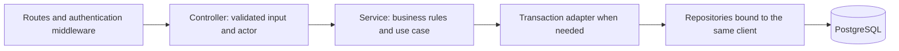

# Node service architecture review and refactor plan

Date: 2026-11-08. Scope: backend, realtime, shared Node contracts/helpers, browser modules and their tests/build paths. Implementation status: the planned Node feature boundaries are implemented. The findings below document the pre-refactor baseline.

The existing product scope and fleet conventions still apply. Keep Express/EJS, the separate Socket.IO process, PostgreSQL/PostGIS and the Go gateway. This work does not introduce another framework, workspace packages, new product features or a new protocol implementation.

## Findings from the current code

Formatting tools are installed, but formatting has not established application boundaries. Most business logic and persistence still live inside HTTP handlers. Prettier also leaves long SQL strings intact, so passing the formatting check does not mean the queries are readable.

| Location | Observed issue | Consequence |
| --- | --- | --- |
| `backend/src/modules/vehicles.ts` | One router implements vehicle CRUD, device creation/enabling, assignments, validation, transactions and audit SQL. Registration and replacement each insert devices separately. | Changes to independent business rules touch the same file. Important rules are coupled to Express and are hard to test separately. |
| `backend/src/modules/auth.ts` | Password hashing, tokens, identity, cookie parsing, session queries, role guards, CSRF and login/logout handlers share one module. | CLI code imports password hashing from a route module; authentication concerns cannot be reused independently. |
| `backend/src/modules/ingestion.ts` | The ingestion transaction is already a useful use-case boundary, but schema validation, admission policy, assignment selection, deduplication, state projection, SQL and gateway routes remain coupled. It throws HTTP-specific errors. | A persistence or transport change requires editing the ingestion rules. An indiscriminate split could break its transaction and lock guarantees. |
| `backend/src/modules/logs.ts` | HTTP parsing, date-range policy, cursor encoding, SQL construction and admin-only raw-data presentation are mixed. | Pagination and redaction policies lack independent tests and reusable typed contracts. |
| `backend/src/modules/realtime.ts` | Ticket HTTP handlers contain session/identity SQL that overlaps the authentication module. | The definition of an active session can drift between browser and realtime paths. |
| `backend/src/jobs.ts` | Outbox leasing/delivery, retention SQL, retries and timer lifecycle are combined. | Scheduler behavior and business jobs are difficult to test separately. |
| `realtime/src/app.ts` | App creation, socket configuration, ticket validation, backend calls, timers, room construction and HTTP fanout share one factory. | Authentication and delivery depend directly on Socket.IO and on an untyped HTTP helper. |
| `shared/http.ts` | Logger creation, an error class, request IDs, service authentication, database-to-HTTP error mapping and an outgoing HTTP client are bundled. | Unrelated responsibilities change together. Every unique database conflict receives the same generic message. |
| Persistence and request context | Most `pg` calls omit row types; `res.locals.user` and internal JSON responses are effectively unchecked. | A clean TypeScript check can still hide misspelled fields or a mismatched service response. |
| `backend/src/browser/types.ts`, `common.ts` | Browser response shapes are maintained separately from server responses. `api<T>` asserts a shape without checking it. The common module also attaches a logout listener on import. | Contract drift is not reliably detected, and importing a helper has a page-side effect. |
| Browser vehicles/log pages | Fetching, form actions, rendering, pagination state and reconnect lifecycle share page-level files. | Tests need the whole page to exercise smaller behaviors. |
| Existing tests | Local tests cover helpers, HTTP access protection, realtime behavior and templates. The PostGIS test concentrates ingestion checks in one scenario; registration/reassignment coverage relies heavily on the Docker smoke flow. | File moves alone cannot establish that transaction-sensitive behavior is preserved. |

These findings describe coupling and maintenance risks. They are not evidence that every current transaction or authorization check is incorrect.

## Target structure

Organize by feature first, then by responsibility within substantial features. Keep top-level `backend`, `realtime`, `shared` and `gateway` directories. Do not restore the former monorepo wrappers.

```text
backend/
  src/
    server.ts                    # Process startup and shutdown
    app.ts                       # Express configuration and route mounting
    bootstrap.ts                 # Construct repositories, services and controllers
    config/
      env.ts
    database/
      pool.ts
      transaction.ts
    http/
      middleware/                # Headers, errors, request IDs; no feature SQL
      health.routes.ts
      pages.routes.ts
      request-context.d.ts
    modules/
      vehicles/
        vehicles.routes.ts       # Paths and middleware ordering
        vehicles.controller.ts   # HTTP input/output translation
        vehicles.service.ts      # Business rules and use cases
        vehicles.repository.ts   # Typed PostgreSQL queries and row mapping
        vehicles.schemas.ts      # Feature-specific boundary validation
      auth/                      # Login/session use cases, repository and guards
      devices/                   # Device persistence and enable/profile policy
      assignments/               # Explicit reassignment use case and locking
      device-logs/               # History, detail, cursor and redaction policy
      ingestion/                 # Admission, dedupe and state projection
      realtime-access/           # Ticket issuance/consumption and active identity
      audit/                     # Transaction-bound audit writes
      outbox/                    # Enqueue, claim, completion and retry persistence
    jobs/
      scheduler.ts
      outbox.job.ts
      retention.job.ts
    browser/
      shared/                    # DOM, HTTP and time helpers
      vehicles/                  # Page entry, form actions and table rendering
      device-logs/               # Page entry, history, detail and live connection
      login.ts
    views/
      partials/
    public/
  migrations/                    # Existing checksummed files remain unchanged
realtime/
  src/
    server.ts
    app.ts
    bootstrap.ts
    config/env.ts
    clients/backend.client.ts    # Typed, validated backend API operations
    http/events.routes.ts
    http/health.routes.ts
    sockets/auth.middleware.ts
    sockets/session-monitor.ts
    sockets/rooms.ts
    services/fanout.service.ts
shared/
  contracts/                     # Transport schemas and browser-safe public types
  errors/application-error.ts
  logging/logger.ts
  http/                          # Small incoming/outgoing HTTP helpers
  security/                      # Only mechanics genuinely shared by Node services
```

This tree describes ownership, not a requirement to create every listed file at once. Add a separate mapper, policy, schema or port file only when it has an independent responsibility. Small read-only endpoints may keep their HTTP handlers together. Do not create empty controllers or one-line forwarding services solely to satisfy a folder template. Retention persistence must have a named maintenance owner, rather than turning the scheduler into another SQL container.

## Request, dependency and transaction flow



1. Routes register paths, authentication/CSRF/role middleware and controllers.
2. Controllers parse transport input, obtain a typed server-derived actor and call a use case. They do not execute SQL or own transactions.
3. Services accept ordinary TypeScript values, small dependency contracts and explicit options. They do not depend on Express request/response objects, cookies, Socket.IO, `process.env` or PostgreSQL SQL statements.
4. Repositories own parameterized, multiline SQL, typed database rows and persistence mapping. Public data-access methods require the relevant organization/device scope. Gateway registry lookup is an explicitly service-authenticated exception with a distinct interface, not a tenant-scoping bypass in a generic repository.
5. Bootstrap constructs concrete implementations once and passes dependencies through ordinary factories. Use small structural interfaces where they create a real testing or integration boundary. A dependency-injection container, base service and generic repository are unnecessary.
6. Services produce application errors with stable codes. HTTP middleware maps them to the existing response/status contract. Translate known PostgreSQL constraints at the persistence boundary; do not expose raw database errors or silently change public error responses during extraction.

A service owns the **business transaction boundary**. The PostgreSQL transaction adapter owns BEGIN/COMMIT/ROLLBACK and gives the service operation repositories bound to one client. Use a narrow transaction context for registration/reassignment, and another for ingestion if their needs differ. Individual repositories must not open independent transactions or fall back to the pool while a use case is in progress.

Preserve these specific atomic operations:

- Registration: vehicle + device + assignment + audit, all or none.
- Replacement: assignment lock + optional device creation + closing/opening assignments + state reset + audit.
- Ingestion: assignment synchronization + device lock + receipt + log + GPS/state effects + outbox.
- Ticket consumption: the existing single-use deletion and active-session check remain atomic.
- Outbox: preserve claim/lease boundaries; perform network delivery outside the claim transaction and record completion/retry afterward.

Keep existing lock names, acquisition order, dedupe identity and temporal comparison rules during extraction. The first pass preserves SQL semantics; reformat queries without changing literal values or parameters. Existing migrations are immutable. Any later schema change requires a new migration.

## Applying SOLID and DRY concretely

| Principle | Application here |
| --- | --- |
| Single responsibility | HTTP translation, business decisions, SQL, cryptographic helpers and timer lifecycle get separate owners. |
| Open/closed | Add a feature operation through a focused service/adapter. Keep protocol-profile facts in the existing explicit allowlist; do not infer or generalize undocumented device behavior. |
| Liskov substitution | There is little inheritance today, so inheritance is not the primary defect. Real and test implementations of a narrow repository/client contract must have the same success, missing-record and failure semantics. |
| Interface segregation | A log reader needs scoped read operations, not every device mutation. The realtime service needs consume-ticket/authorize operations, not the entire backend or a raw HTTP client. |
| Dependency inversion | Services depend on narrow capabilities; bootstrap supplies PostgreSQL, clock, token and HTTP implementations where those boundaries are actually needed. Use functions and composition rather than forcing classes. |
| DRY | Centralize the same policy or invariant, not merely similar-looking code. Preserve differences between ordinary registration and replacement defaults, and between user, gateway and realtime authentication. |

First DRY extractions:

- Password hashing and token primitives independent of auth routes, so CLI setup does not import Express modules.
- One active-session/identity repository operation reused by HTTP session lookup and realtime authorization, with ticket consumption retaining its atomic wrapper.
- Device creation/profile lookup shared by registration and replacement where semantics match. Make defaults explicit before consolidating the two insert paths.
- Transaction-bound audit and outbox persistence used by relevant services.
- One owner for each public request/response/event contract. Repository rows, application values and public responses remain distinct; do not rename existing snake_case response fields as a side effect.
- Pure browser HTTP/DOM/time helpers; attach logout behavior explicitly from a page initializer.
- Typed backend-client methods in realtime with runtime schema checks for internal JSON responses. A generic `response.json()` assertion is insufficient at a trust boundary.

Public DTO declarations must be browser-safe. Account for the browser compiler's current `rootDir` before moving types: use type-only shared declarations or an explicitly adjusted browser output layout, and verify emitted URLs. Do not pull PostgreSQL, Express, Node crypto or server initialization into the browser build. Do not add a bundler just to share a handful of types.

## Implementation sequence

| Phase | Concrete work | Completion evidence |
| --- | --- | --- |
| 1. Characterize behavior | Inventory existing public/private routes, response shapes and middleware order. Add missing registration, replacement, session/ticket, log authorization and outbox failure-path tests. Record current query/transaction behavior. | Tests exercise the actual current implementation, including failure rollback and cross-tenant denial. Establish a real PostGIS baseline before changing transaction paths. |
| 2. Establish the boundaries | Split `shared/http.ts`; extract password/token primitives; type identity, Express locals, database rows and internal responses. Introduce bootstrap and narrowly scoped dependencies. | No CLI import from a route module; existing auth and error contracts pass unchanged; app factories start no listeners/jobs on import. |
| 3. Refactor one vertical slice | Extract vehicles together with device and assignment operations into HTTP/service/repository responsibilities. Preserve a single transaction context and audit writes. Format owned SQL as readable multiline statements. | Registration conflict/concurrency, replacement, disabled device and tenant-isolation tests pass on real PostgreSQL. Use this slice as the pattern for later modules. |
| 4. Extract auth, logs and realtime access | Separate login/session policy and storage; share active identity logic; isolate cursor/date/redaction rules; consolidate DTOs with explicit response mapping. | Session expiry/revocation, one-use ticket races, date bounds, keyset pagination, raw-data redaction and existing page access tests pass. |
| 5. Extract ingestion and jobs | Separate pure admission/fingerprint/time/projection decisions from transaction-bound persistence. Split outbox delivery, retention and scheduling. | Duplicate and historical records retain their current effects; partial writes roll back; assignment locks, outbox leases, retry/lost-response behavior, retention protection and shutdown drain are tested. |
| 6. Refactor realtime and browser flows | Introduce the backend client, socket identity/session monitoring, fanout service and explicit lifecycle cleanup. Split page state/API/rendering only where responsibilities warrant it. | Real socket auth, revocation, foreign-organization denial, reconnect/resync, form submissions, escaped rendering and details loading work through the running application. |
| 7. Enforce and remove transitional code | Update build paths, Docker COPY/commands, asset URLs, CLI imports and tests. Add import restrictions for each boundary and remove old modules once no callers remain. | Clean `npm ci`, quality/build/tests and both Compose configurations pass; no duplicate old implementations or re-export chains remain. Docker smoke and browser checks run against the final image layout. |

Each phase should be a small, reviewable change with its tests. Keep current routes and process separation throughout. Avoid a branch-wide file move followed by a large behavior rewrite.

## Enforcement and acceptance

Extend the existing ESLint setup with import restrictions so route/controller files cannot import `pg` or database adapters, services cannot import Express/Socket.IO, repositories cannot import controllers, and browser code cannot import server modules. Limit SQL to repositories/database/explicit migration and test-fixture code. Architecture restrictions must cover transitive access through shared helpers as well as obvious direct imports. Tighten unsafe-type lint rules on migrated boundaries after their data has been typed; do not disable all checks globally.

Use unit tests for pure policies and service failure decisions, HTTP tests for validation/permissions/response mapping, real PostGIS integration tests for locks and transaction effects, and actual Socket.IO/browser checks for lifecycle behavior. Fake repositories do not prove database isolation, constraint behavior or rollback. Require the real database checks in CI; local skips remain visible. Avoid adding tests that simply mirror every forwarding function or assert folder names.

Acceptance criteria:

- HTTP handlers no longer contain business transactions or feature SQL.
- Business use cases can be tested without starting Express, Socket.IO or a real network server.
- Every transaction-sensitive operation retains its original atomicity and ordering.
- Tenant and role decisions use server-derived typed context at the service boundary, including non-HTTP callers where applicable.
- Realtime delivery still follows persistence; sockets remain notifications and REST remains the resync source.
- Shared modules have explicit owners and narrowly named responsibilities; no catch-all `utils`, base controller or universal CRUD abstraction is introduced.
- Application source and SQL are readable; reference documents and existing SQL migrations are not cosmetically rewritten.
- API paths, status/envelope contracts, cookies, protocol gates, browser behavior and persisted data remain compatible.
- Build paths, Docker images, CLI tooling and CI reflect the new structure; generated artifacts stay ignored.

## Pre-refactor verification baseline and limits

The review reran `npm run quality` and `npm test`. Eight tests pass; the real PostGIS test is skipped without `DATABASE_TEST_URL`. At review time the quality suite checked types, lint and formatting, but did not enforce architectural boundaries. This is not production or real-database acceptance evidence. At the analysis stage, only this plan document was added.

## Implementation record

- Added real-PostGIS characterization before extraction: registration concurrency, forced-audit rollback, replacement history, permissions, raw redaction and one-use ticket races.
- Extracted actor context, domain errors, security helpers, typed repositories and shared contracts. CLI setup imports password hashing independently of HTTP routes.
- Split vehicle/device/assignment use cases while preserving one transaction client, locks, audit writes, defaults and public response fields.
- Extracted authentication, active-session lookup, log pagination/redaction, ticket consumption, ingestion persistence/admission, outbox persistence, retention and scheduling.
- Split realtime authentication, session monitoring, validated backend requests and transport-independent fanout.
- Split browser page state, forms, tables, response decoders and reconnect lifecycle. Shared helpers are side-effect free; entry points initialize behavior explicitly.
- Added architecture lint enforcement, service policy tests, scheduler drain tests, real outbox lease/lost-completion/retention tests, and updated build/CLI imports. The deployed migration and Go protocol implementation are unchanged.
- Real PostGIS test run: 22 checks passed with no skips. All Node and gateway Docker images built. All 12 running-stack smoke checks and 11 real-browser flows passed, including a realtime restart and viewer permissions. Container startup also exposed and fixed a TCP-readiness probe race; the smoke CSRF selector now accepts formatted HTML.

## Subsequent layout update (2026-11-08)

Applications and Dockerfiles now live under services/, operational tooling under utils/, and deployment uses one compose.yaml on HTTP port 80. See README.md for current paths and commands; the earlier sections above record the original refactor layout.

The grouped service layout was validated with 22 real-PostGIS checks (no skips), separate backend/realtime/gateway/proxy image builds, all 12 Docker smoke checks and 11 real-browser flows on HTTP port 80. Configuration verification confirmed that only 80, 5001 and 5002 are published.
