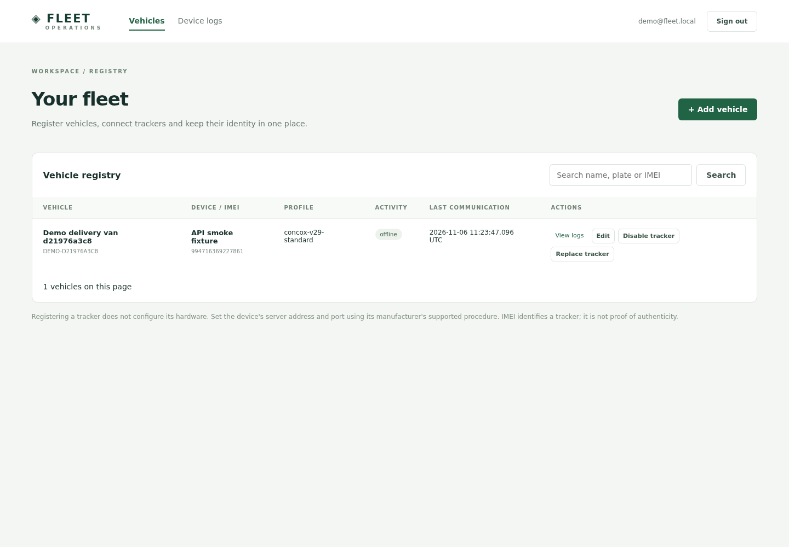
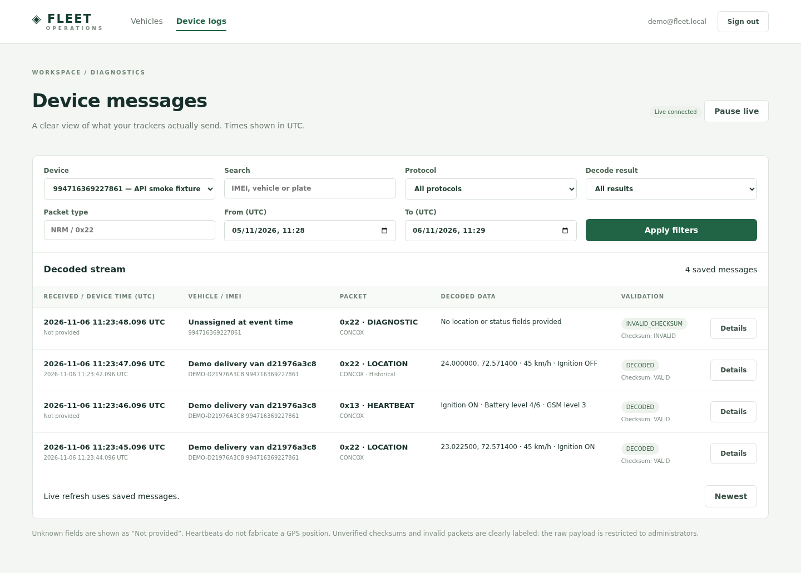

# QA PASS WITH NOTES

- QA mode: Quick
- Preview: http://localhost:8080
- Target SHA: 05e7ada6d1af1d010f5aaeb7a646900c609e8861
- Tested SHA: 05e7ada6d1af1d010f5aaeb7a646900c609e8861
- Deployment: local fleet Docker Compose services, built from this workspace; real Express, PostgreSQL/PostGIS, Nginx and Socket.IO
- Local revision: the SHA fields above identify a deterministic runtime-source SHA-1 snapshot, **not a Git commit**. The mounted .git directory is not a usable repository. Snapshot scope: backend/realtime source, shared runtime packages and Nginx configuration. These sources stayed unchanged after the successful browser check; later package edits only serialized test execution.
- Workspace: Fleet demo workspace; administrator demo@fleet.local; synthetic tracker994716369227861 from the first API smoke run
- Tools: Playwright / Chromium 150.0.7871.181 (Playwright 1.58.2)
- Viewport:1440 x1000

## Scenarios

| # | Scenario / criterion | Role | Mode | Result | Evidence |
| --- | --- | --- | --- | --- | --- |
| 1 | Sign in with actual demo credentials and see the persisted registered vehicle | Demo admin | Live | Pass | Browser login and table assertions; screenshot01 |
| 2 | View saved messages with correct location, speed, battery level, history and checksum status | Demo admin | Live | Pass | Four persisted messages;45km/h,23.022500, battery level4/6, Historical and INVALID_CHECKSUM visible; screenshot02 |
| 3 | Open decoded JSON details and see the synthetic diagnostic/raw value | Demo admin | Live | Pass | Detail JSON contained simulated=true and raw_data=0000; modal closed normally |
| 4 | Reload and reconnect to real Socket.IO through Nginx | Demo admin | Live | Pass | Live connected and four saved messages restored; zero page errors and zero failed same-origin requests |

## Findings

An initial browser run exposed403 responses on the Socket.IO polling handshake. Same-origin browser GETs omitted Origin, but the server required that header. The server now permits an absent/matching Origin while still enforcing ticket authentication; explicit foreign origins remain rejected. The corrected real browser flow passed, and unit regression checks cover both the Origin and authentication boundaries. This defect originated in the initial realtime implementation and is resolved.

## Notes

This is a local Docker run, not a cloud preview or physical tracker test. The browser read actual persisted data created by the separately authorized API smoke test; there were no browser API interceptions, fabricated DOM states or in-memory database substitutes. Only the existing demo workspace was accessed. The password was read privately from .env inside the temporary runner and was not printed or captured.

The screenshots were inspected for legibility and correct device/message state. They contain synthetic fixture identifiers, not a real customer's vehicle data. The first demo fixture is deliberately retained; the final API smoke run added a second fixture. Browser contexts and the temporary runner were closed. Git status comparison was unavailable; runtime source was identified by the explicit content snapshot above. Neither hardware protocol correctness nor exhaustive security coverage is claimed by this focused browser pass.
