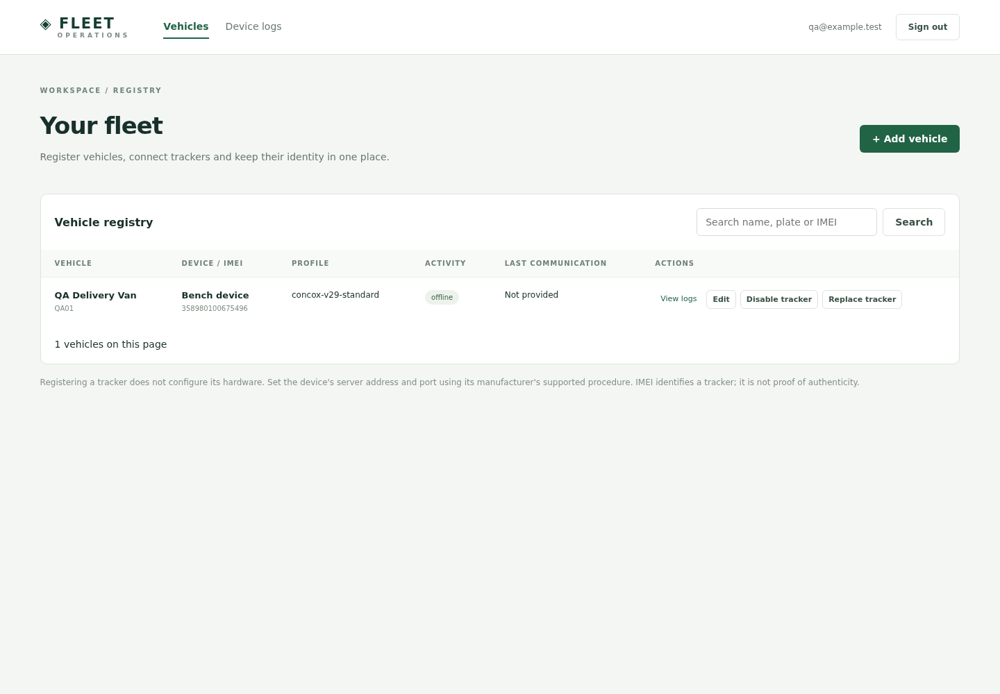
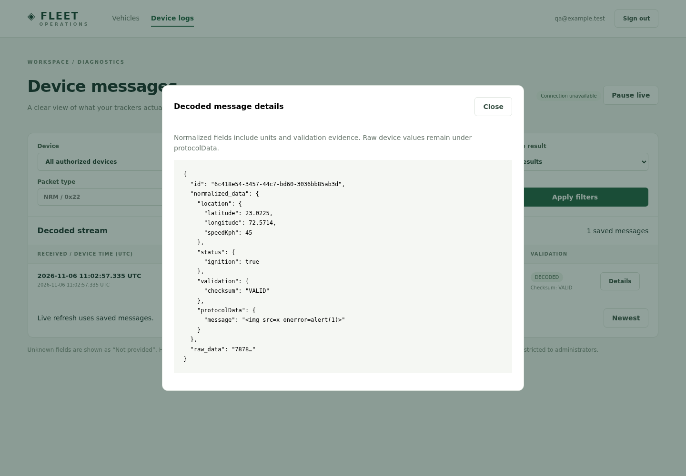

# QA BLOCKED

- QA mode: Quick
- Preview: temporary loopback Express server from `/home/soham-patel/Desktop/Projects/fleet-backend`; ephemeral port closed after each run
- Target SHA: unknown (workspace has no usable Git repository)
- Tested SHA: unknown (unversioned working tree)
- Deployment: local `createApp` and real EJS/public sources; a memory-only PostgreSQL test double supplied the simulated UI identity/data. No external or production services were contacted.
- Local revision: final source digest `9f0e6abcdd5ef16afd9155683b2700ba3707f5321c1091df977922e4d6fd472e`; screenshots precede the final filter-submit pause, historical-association/privacy and deployment-template changes. Current full browser recheck is blocked, not a claim of equivalent tested revision.
- Workspace: isolated QA fixture organization/admin (`qa@example.test`); public login rendering required no identity. All fixture records existed only in process memory and were discarded.
- Tools: Playwright / Chromium 150.0.7871.181 (Playwright package1.58.2)
- Viewport: 1440 x 1000

## Scenarios

| # | Scenario / criterion | Role | Mode | Result | Evidence |
| --- | --- | --- | --- | --- | --- |
| 1 | Express renders the public login screen | Anonymous | Live | Pass | Actual EJS heading asserted in Chromium; this does not test credential authentication |
| 2 | Invalid short IMEI prevents form submission | Fixture admin | Simulated | Pass | Browser form validation kept memory fixture registry empty |
| 3 | Valid registration submits, renders and survives a page reload in the test double | Fixture admin | Simulated | Pass | Screenshot01 and successful browser assertions; real PostgreSQL persistence is not proven |
| 4 | Log view renders decoded location/speed and detail JSON; hostile text does not create HTML | Fixture admin | Simulated | Pass | Screenshot02; speed45km/h, literal injected HTML text, zero img elements in detail and no browser page errors |
| 5 | Final browser revision, including pause-on-filter-submit | Fixture admin | Simulated | Blocked | Final loopback bind failed with EPERM; previous screenshots remain explicitly earlier evidence |
| 6 | Real database registration/assignment/history and authenticated live delivery | Real user/organization | Live | Blocked | No accessible PostgreSQL/PostGIS instance; Docker daemon denied; real device/firmware captures unavailable |

## Findings

The initial exact-label selector exposed an accessibility labeling issue on the populated protocol dropdown. Adding an explicit accessible name fixed it, and the simulated main flow passed after the correction. A premature test assertion on async details was corrected to wait for rendered content; it was a harness timing issue.

The final browser attempt failed to bind even an ephemeral loopback port (`listen EPERM`). Fixed-port to ephemeral-port fallback worked in an earlier run; the same restriction later recurred. No further tooling switch could establish a real database or overcome socket permissions. Start the Compose stack in an environment with Docker/socket access, bootstrap a real admin, then rerun registration, replacement, tenant denial, history filters and reconnect against real PostGIS and physical devices.

The screenshots were visually inspected: readable vehicle identity/actions and escaped JSON details. They contain only synthetic fixture identifiers and a fake email. The visible “Connection unavailable” state reflects the intentionally absent realtime backend in this UI simulation; it is not a live-delivery pass. Temporary browser contexts and fixture servers were closed; no fixture records remain.

## Other verification evidence

- `npm run check`: passed.
- `npm run format:check`: passed.
- Skill `quick_validate.py`: passed.
- `npm ci --dry-run --offline --ignore-scripts --no-audit --no-fund`: passed; validates dependency-tree consistency, not a fresh download/audit.
- `docker compose config --quiet` for both development and production override with throwaway required environment values: passed; no containers started.
- `node --import tsx --test --experimental-test-isolation=none tests/*.test.ts`: six passed, one real-PostGIS integration test skipped. Covers contract validation, dedupe identity, password verification, anonymous/internal HTTP protection and socket organization fanout using an explicit auth-service test double.
- Default isolated Node test subprocesses encountered local socket EPERM on later runs; the single-process runner completed. This is not a replacement for CI.
- Go toolchain absent: Go compilation, vet/race/fuzz and gofmt have not run locally. CI and Docker build commands are provided but have not run remotely.
- Database migrations, SQL constraints, retention and physical ACK timing remain unverified until the PostGIS/Go/hardware prerequisites are available.

Source digest excludes `.docs`, runtime dependencies, QA artifacts and temporary scripts; it includes applications, packages, scripts, tests, infra, skill, CI, manifests and Compose. Git status could not be compared because the mounted `.git` directory is not a usable repository. Relevant unversioned files were inspected directly. No final product changes were made by the browser QA harness.
